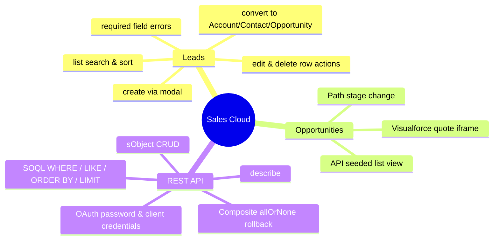

# Playwright × Salesforce Lightning

[](https://github.com/mukeshn/playwright-salesforce-lightning/actions/workflows/playwright.yml)
[](https://mukeshn.github.io/playwright-salesforce-lightning/)


[](LICENSE)

UI and API automation patterns for Salesforce Sales Cloud. It covers Lightning components behind shadow DOM, row-action menus, toasts, the opportunity Path, a Visualforce page inside an iframe, and the REST API (OAuth, sObject CRUD, SOQL, Composite with `allOrNone`).

There's no Salesforce org to hand out publicly, so the repo bundles a Lightning-style app and a REST mock that copies Salesforce's URLs, record IDs (`00Q…`, `006…`) and error payloads (`REQUIRED_FIELD_MISSING`, `INVALID_SESSION_ID`, `PROCESSING_HALTED`). The page objects and API client are written so they can be pointed at a real scratch org.

## Why Playwright works well on Lightning

| Lightning pain point | How it's handled here |
|---|---|
| LWC renders inside **shadow roots** | Playwright's role, label and CSS engines pierce open shadow DOM, so `getByLabel('* Company')` simply works |
| Generated, unstable ids | role/label locators only, no ids or XPath |
| Toasts appear and disappear | `expectToast()` asserts on `role=alert` with auto-waiting |
| Row actions in menus | `ListViewPage.rowAction('Acme', 'Edit')` |
| Visualforce in iframes | `page.frameLocator('iframe[title="Quote Calculator"]')` |
| Slow UI data setup | records are created through REST, and the UI is only used for the behaviour under test |
| Test data pollution | `track()` fixture deletes every record a test creates, even when it fails |

## Coverage



## Example

```ts
test('converting a lead creates account, contact and opportunity', async ({ lightning, sf, track }) => {
  const leadId = await sf.create('Lead', { FirstName: 'Jan', LastName: 'Keller', Company: company });
  track('Lead', leadId);

  await lightning.openRecord('Lead', leadId);
  await lightning.button('Convert').click();
  await lightning.expectToast('Your lead has been converted');

  const lead = await sf.get('Lead', leadId);
  expect(lead).toMatchObject({ IsConverted: true, Status: 'Closed - Converted' });
});
```

## Run

```bash
npm ci
npx playwright test               # ui + api projects
npx playwright test --project=api
npx playwright test --ui
```

<details>
<summary><b>Pointing it at a real org</b></summary>

1. Create a Connected App with the OAuth password or client-credentials flow enabled.
2. Set `BASE_URL` to your My Domain URL and update `ORG` in `src/api/SalesforceApi.ts` (or load it from env).
3. Swap the `page` fixture's login for a `frontdoor.jsp?sid=` redirect using the API access token.
4. Leave out the mock-only specs (`tests/auth/login.spec.ts`) and run the rest.
</details>

<details>
<summary><b>Project layout</b></summary>

```
src/
  api/SalesforceApi.ts      OAuth, CRUD, SOQL, Composite, Apex REST
  pages/LightningPage.ts    toast, modal, combobox, record helpers
  pages/ListViewPage.ts     datatable rows, search, sort, row actions
  pages/LeadForm.ts         New/Edit Lead modal
  fixtures/test.ts          session injection, sf client, auto-cleanup
tests/
  auth/ leads/ opportunities/ hybrid/ api/
sut/                        Lightning-style UI + REST mock
```
</details>

---
Selenium version of the same app: [selenium-salesforce-lwc-automation](https://github.com/mukeshn/selenium-salesforce-lwc-automation)
